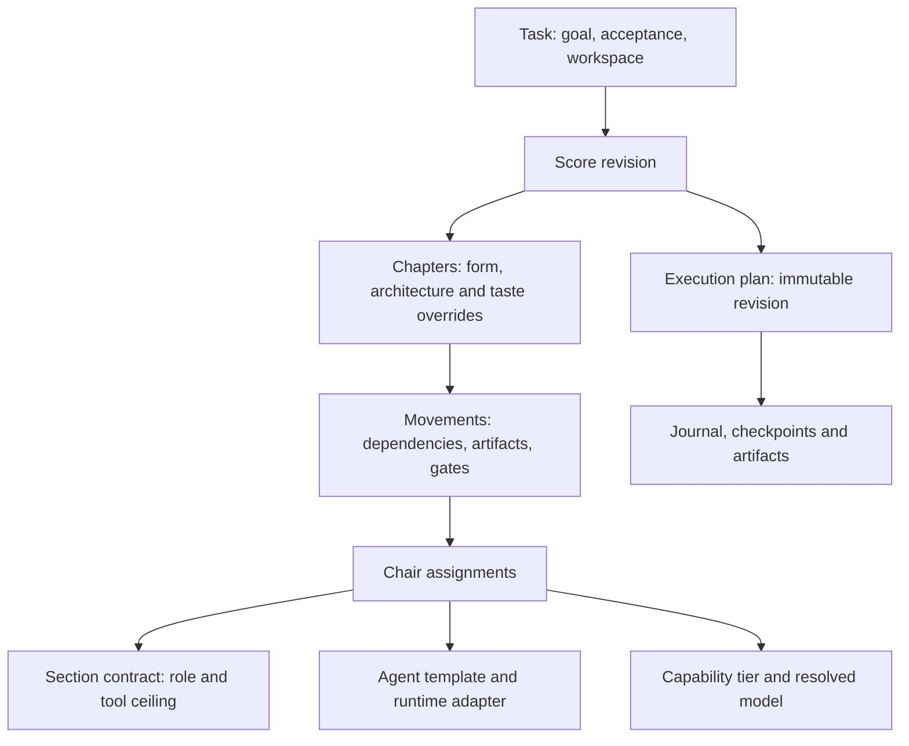

# Task-driven Concert Hall — design RFC

Status: proposed architecture, not a released Score v2 schema or an implemented durable runner.
This RFC revises the third-step WebUI direction. PRs #5 and #6 supply the current
flat score planner and read-only monitor; the unsubmitted WebUI draft remains an
experimental monitor. No GPU experiments, agent execution or DSH deployment were
performed for this research.

## 1. Decision

Make Philharmonie a task-driven orchestration workspace with its own application
shell. Treat DSH, Hermes, Codex and other supported environments as adapters.
Within DSH, contribute a global Concert Hall panel and a compact header action;
the independently owned Hall provides the full-width ribbon, score editor and
orchestra stage. A new upstream Ribbon slot is an optional future improvement,
not a prerequisite for the product.

The primary journey is:

> Task goal → acceptance and constraints → architecture/method choices →
> composite score → chapters and movements → chair/agent/model bindings →
> preflight → execution evidence and iteration.

The current roster/status page becomes the **Performance** view. It is not the
entry point for authoring a long task.

## 2. Source findings and component adaptation

DSH research baseline: `deepseek-ai/deepseek-harness@687f282e8625c6b8d11ff58211a90524be2e4317`.
This is the master revision returned during this research. Findings below are
from source and documentation, not a visual audit of a running DSH instance.

| Existing DSH surface | What the source supports | Philharmonie adaptation |
|---|---|---|
| `sidebar.panellist` + root `main` keyed entry | A labelled global panel, independently selected with `layout.selectPanel` | Register Concert Hall here. It can author tasks before a chat Session exists. |
| `conversation.session.header.actions` | Additive, title-adjacent controls; hidden with blank-session chrome | Small task/run indicator that opens the Hall or an accessible inspector. It cannot be the only entry point. |
| `conversation.view` | Session-scoped alternate Views; blank Sessions omit this slot | Optional per-Session Score/Run View, useful for inspection rather than creating tasks. |
| `conversation.content` Component Factory | Reusable body/composer without the main header; local `views` and `widthControls` positions | Candidate for embedding a DSH conversation inside the Hall's optional chat dock, through public Factory composition and a valid Session binding. Prototype this before promising embed support. |
| `ConversationSessionHeader` | Owns breadcrumbs, actions, utilities, corner and tabs | Preserve its navigation behaviour. Do not copy a private component merely to insert a row. |
| Header CSS | Two-column grid, 76px reference geometry with tabs, desktop drag/clearance rules | A full-width addition requires coordinated owner/layout changes; changing only JSX or forcing an absolute-positioned board is insufficient. |
| `header.corner` and `lineage` | Single cells already occupied by shipped features | Do not take these cells for an additive Hall feature. |
| Right sidebar/dock | Its Session-scoped occupant is tied to the Conversation selection | Keep Hall inspectors in our own layout; do not make them depend on a right dock that disappears when the Hall main panel is selected. |
| `ui-primitives`, theme and store packages | Shared controls, observable stores and presentation tokens | Use their public exports in the DSH adapter. Keep the standalone renderer's theme and transport independent. |
| Host `connection.fetch.register` and `llm.listProviders/listModels` | Authenticated owner-facing routes and a current model directory | Bridge configured tasks to host models; intersect declared tier capabilities with the actual available directory. Never infer capability from a model's name. |

Important source constraints:

- Slots have explicit declaration owners. Registering an undeclared Ribbon slot
  fails activation; a string chosen by our plugin cannot create that location.
- DSH's composition rule says a feature contributes through Slots rather than
  importing another feature's private React component. Prefer adapter wrappers,
  public Factories and public primitives over copying the whole Conversation.
- One Session's composer does not support simultaneous editable roots. A Hall
  chat dock must transfer ownership or mount one occurrence, not duplicate the
  active editor beside the normal Conversation.

If an upstream full-width extension is later useful, its coherent patch spans
the slot type declaration, the registration owner's `children`, the header's
`PropsRenderSlots` share, the render site and grid/desktop styles. It needs
blank-session, macOS drag, Windows clearance, narrow-layout and unload tests.
The independent Hall can ship without that patch.

## 3. Separate the dimensions users are composing

| Dimension | Example values | What it actually changes |
|---|---|---|
| Task family | software delivery, kernel/invariant repair, AI4S experiment | Required inputs, evidence and completion criteria |
| Deployment profile | serverless, local process, cluster | Packaging, runtime limits, resources and deployment checks |
| Architecture packs | microkernel, event-driven, DDD | Module/domain/event boundaries, artifacts and architectural fitness gates |
| Composition form | sonata, fugue, developing variation, bounded experiment loop | Ordering, fan-out/join, repetition, review and exit policy |
| Taste policy | minimal API, explicit dependencies, accessible UI, reproducibility | Review rubric plus machine checks where available; subjective claims retain an explicit reviewer |
| Agent template | contract writer, implementation worker, reviewer | Instructions and tool subset within the selected Section contract |
| Runtime and model binding | Codex/Hermes/DSH adapter + capability tier + available model | How a chair is executed and what capabilities it can actually use |

These are not one mutually exclusive style selector. For example, a serverless
application can use DDD inside bounded contexts, events between contexts, and a
microkernel-style extension boundary only where plugins are needed. Selecting
every pack must not automatically be treated as a sound architecture: compile
the choices into explicit obligations and report conflicts or unnecessary scope.

EDA is provisionally interpreted here as **Event-Driven Architecture**. Electronic
design automation, if intended, belongs to a separate hardware task family with
its own tools, artifacts and verification gates.

Composer names remain convenient presets. A Beethoven preset should explain its
invariant-first heavy-wave policy; it must not silently select a commercial model
or grant Heavy Brass admission. A chapter may change form while retaining the
task's shared constraints and frozen evaluation/contract artifacts.

## 4. Small domain model, with distinct execution identities



- **Task** owns user intent and completion. It is not a chat Session.
- **Score** is the editable composition; runs pin an immutable revision.
- **Chapter** is a meaningful milestone, with a local form and explicit overrides.
  Do not add another mandatory hierarchy between Task and Score.
- **Movement** is a scheduling node or an explicitly bounded group. Its inputs,
  outputs and exit gates must be inspectable.
- **Section** is the existing logical contract. **Chair** is an instance of it.
  `frontend.impl` and `backend.impl` can both be Violin I while using different
  worktrees, agents or models. Moving a visual chair never increases its ceiling.
- **Binding** separates the agent's instructions, its runtime transport and its
  model selection. A model dropdown alone does not configure an agent.
- **Run** owns execution attempts and checkpoints. One Task can reference many
  DSH Sessions and non-DSH processes through adapter-owned `runtime_refs`.

Use stable `chapter_id`, `movement_id` and `chair_id`; display indices are not
durable identity. A run address also needs `run_id`, `plan_revision`, optional
`iteration_id`, and per-launch `execution_id`. This prevents two Violin I workers
or repeated scientific trials from overwriting one another's state.

The existing v1 planner has a root style, generates four serial movements, and
uses Section names as seat identities. Its dependency validator permits only
earlier movements. Preserve this contract for existing users; a composite Score
needs a separate authoring document and compiler rather than silently accepting
new nested fields in `templates/score-schema.json`.

Current limits also include a planning-only `max_turns` field (the spawn wrapper
does not enforce it), a read-only state reducer rather than a scheduler, and no
durable pause/resume or experimental decision engine. A tier declaration is host
configuration, not a benchmarked guarantee. The next runner must either enforce
each selected constraint through its adapter or report unsupported capability.

## 5. Graphs, loops and recovery

Keep a DAG between chapters and a DAG within each finite movement group. Express
repetition as an explicit bounded group whose body is a DAG. Do not add arbitrary
back-edges to the current dependency list and call them a durable loop engine.

| Form | Scheduling behaviour | Required visible boundary |
|---|---|---|
| Sonata | Establish contract → one implementation wave → review/verification | Locked contract and acceptance |
| Fugue | Isolated implementation branches → counterpoint → conductor integration | Exact expected branches and a join gate |
| Developing variation | Small change → verify → checkpoint → next slice | Immutable ground bass and progress ledger |
| Experiment loop | Propose → patch → execute → measure → judge → keep/discard | Protocol, baseline, valid metrics and iteration budget |

Compilation should check role/tool ceilings, artifact dependencies, isolation,
runtime support, resource availability and budget before admitting a plan to a
runner. A Pi runtime without model pinning or a host without the required GPU
remains unsupported, even if a browser can draw the corresponding chair.

Runtime state must survive browser closure: draft/compiled state belongs to the
authoring service; execution/checkpoints belong to the runner; browser layout
preferences belong to the client. Do not put execution in a UI timer.

A durable increment will need an append-only run journal, exact child identities
at joins, idempotent command/attempt identities, artifact provenance and restart
reconciliation. Resume at a verified checkpoint. An external job whose outcome
is unknown must be reconciled before rerunning; no implicit exactly-once claim.
Keep the transport small and local first—this does not require a new message bus.

Edits create the next Score revision. Running attempts continue to reference the
old plan. Pause means no new dispatch; an already-running trial either finishes
or is explicitly cancelled. Cancel records an interrupted outcome, not success.

## 6. Example: one long full-stack software score

Task: deliver a frontend/backend application with independently testable domain
logic and a serverless deployment target. The following composition illustrates
choices, not a mandate that every project use every architecture.

| Chapter | Local form / profile | Main chairs | Evidence at exit |
|---|---|---|---|
| I. Exposition | Sonata; scope and contract | Oboe + Flute when external investigation is needed | SPEC, API/data contracts, architecture decision records, locked tests |
| II. Domain | Developing variation; DDD if domain complexity warrants it | Violin I + Violin II, small slices | Bounded contexts, dependency constraints, invariant tests |
| III. Construction | Fugue; frontend/backend isolation | `frontend.impl` and `backend.impl`, both Violin I | Separate diffs against the same contract; scoped verification |
| IV. Extension / integration | Microkernel only if a plugin boundary is required; EDA only for selected interactions | Horn, Viola, Violin II | Extension contract, event schemas, idempotency/replay checks where selected |
| V. Tutti / delivery | Integration and serverless fitness | Conductor, Snare, Cymbals | Merged candidate, lint/unit/e2e/security evidence, runtime/deployment checks |

Harp can review visual artifacts within its tool ceiling; a shell/browser runner
produces screenshots. Do not give Harp terminal tools merely because a frontend
task needs browser verification. Review and Snare retain their existing shared-
sounding-tree locks; the plan must say exactly which candidate tree is sounding.

Architecture changes during a long task create a revised future chapter and an
explicit contract migration where needed. They cannot retroactively weaken tests
that certified earlier chapters.

## 7. Example: autoresearch-like AI4S score

The source implementation is deliberately small: an agent edits `train.py`,
`prepare.py` holds fixed evaluation/data/runtime utilities, training uses a
300-second budget excluding startup/compilation, and lower `val_bpb` is better.
The loop records keep/discard/crash decisions and repeats. It is not merely a
four-stage coding task with a progress spinner.

| Chapter | Form | Observable results |
|---|---|---|
| I. Protocol | Oboe-led contract | Editable scope, immutable evaluator/data/tokenizer references, metric direction, comparison policy, resource limits |
| II. Baseline | One shell-backed experiment | Successful baseline, code/evaluation/data/hardware references, metrics and raw logs |
| III. Variations | Bounded experiment loop | Candidate patches, trial outcomes and keep/discard decisions |
| IV. Reprise | Independent validation | Reproduction/holdout protocol as specified, reviewed best candidate and report |

One variation is:

```text
hypothesis → candidate patch → preflight → GPU experiment → metric extraction
    → independent comparison → keep OR discard → checkpoint → next variation
```

Separate scientific iterations from retries of one failed process. `discard` can
be a valid completed experiment. `crash`, timeout or missing metrics cannot rank
as an improved candidate. The source TSV uses zero as a crash placeholder;
normalize such an invalid result to an absent metric with crash status, never a
zero-valued winner in a minimization chart.

An experiment node's process failure is classified under its declared trial
policy before comparison/checkpointing. This does not turn failures of generic
verification gates into successful outcomes or bypass their circuit breakers.

The comparison protocol is fixed before a trial: metric direction, valid status,
baseline/evaluator version, data identity, hardware constraints and any repeat or
non-inferiority policy. If simplicity breaks ties, state the reviewer/rubric;
do not pretend that aesthetic judgement is a measured metric. Changing evaluator,
dataset or hardware starts a new comparison cohort or establishes a new baseline.

The loop exposes iteration/time/compute/token budgets, stop rules, no-improvement
and crash policies, and manual pause. A 300-second training budget is not the
whole job's wall-clock timeout; compilation, loading and evaluation take time.
Resource leases prevent two chairs from silently claiming the same GPU. Rejected
candidate code can be reset in its designated branch/tree while experiment logs
and provenance remain durable.

Evaluator protection is a protocol obligation. The current optional `--lock-bass`
is chmod protection, not an OS sandbox; the same uid can undo it. A real research
execution path must test its selected isolation/tool-enforcement boundary rather
than claim strong evaluator immutability from that flag alone.

Snare's shell can use zero LLM tokens while a training job consumes substantial
GPU time and money. Show token and compute budgets independently. Do not label
the scientific loop as free because its execution chair is 0-token.

The original autoresearch program requests indefinite operation after setup.
That instruction describes its workflow; it is not authority to run an experiment
in this session. Philharmonie should expose a chosen run policy and record it.

## 8. Task-first presentation

```text
Task Library      Goal / acceptance / architecture / resources / Score revision
                  [overall ribbon: chapter · lead chair · run/loop · next gate]
──────────────────────────────────────────────────────────────────────────────
Tasks             Compose | Stage | Score | Performance          Inspector
  Product A       chapter timeline / orchestral stage            selected chair
  Research B      dependency handoffs and explicit loop groups    agent / runtime
  Templates       pending cue, missing capability, next decision  model / ceiling
                  artifacts and experiment comparison            budget / evidence
──────────────────────────────────────────────────────────────────────────────
                  Optional conversation / notes dock
```

- **Compose** starts with the task. Offer task templates, architecture packs and
  form suggestions with an explanation of their scheduling consequences. A user
  can mix chapter forms and override future chapters.
- **Stage** shows the orchestra as role groups and identifiable chairs. Model,
  agent and runtime are separately inspectable. Spatial layout is presentation;
  task dependencies, assignments and gates are the semantics.
- **Score** is the editable chapter/movement score. Support sequence, parallel
  groups and bounded loops before considering a completely general graph editor.
  A form change previews changed chairs, handoffs, constraints and budgets.
- **Performance** shows actual execution and artifacts. Collapse a research loop
  into one group with an iteration ledger; do not paint 100 trials as 100 huge
  graph nodes. For research, show baseline/best/last *valid* candidate plus crash
  and discard records; all counts derive from evidence.

Use layered detail: task/chapters → selected movement/chairs → attempt/tool/log.
The graph, timeline and instrument stage must be projections of the same plan and
journal, not three manually maintained states. The ribbon is a compact projection
of that task, so it works in our own shell even when no DSH Session is selected.

Useful playability comes from editing and previewing compositions, comparing form
changes, remixing a known Score revision and replaying evidence. Preview never
means a real agent run. Execution controls are enabled only when their runner and
admission path exist; unavailable runtime/model/resource support is explicit.

## 9. Implementation sequence and acceptance

1. **Task/Score domain and compiler seam.** Define the authoring document and its
   reader together. Support chapters, stable movement/chair identities, typed
   sequence/parallel/loop groups and explicit profile/taste overrides. Adapt
   compatible leaves to v1 scores. Unsupported forms report unsupported rather
   than silently flattening a loop into a successful plan.
2. **Independent Hall vertical slice.** Two real authoring templates: full-stack
   delivery and bounded research. A user can change a chapter form, bind two
   implementation chairs to different runtimes/models, inspect the resulting
   plan and see unresolved capabilities without a DSH installation.
3. **Durable execution slice.** Add validated dispatch/checkpoint/iteration paths
   to the existing latches. Demonstrate a resumable coding variation and a fake-
   experiment fixture before a real scientific workload. Verify scope protection,
   known/unknown job reconciliation, exact joins and metric provenance.
4. **DSH thin adapter.** Sidebar/main panel plus header action using supported
   slots; optional Score View or public Conversation Factory embedding. Add
   capability negotiation for model catalog, session view and job controls.
   Profile/Session switching must not silently switch the task's active run.

Keep the existing tool ceilings, Tacet, shell ladder, hall capability checks and
admission separation. The new domain should make those constraints visible, not
replace them with musical labels.

Minimal acceptance scenarios:

- One task uses serverless + DDD, and one selected chapter adds EDA obligations.
- One Score mixes contract-first, parallel implementation and gated variation.
- Two Violin I chairs retain separate worktrees, bindings and attempt histories.
- A research Score records baseline, keep, discard and crash; a crash cannot win.
- Pause/restart preserves the next iteration and the pinned Score revision.
- A missing model/GPU or unsupported runtime blocks admission with a clear reason.
- Opening the same task in standalone Web, TUI or DSH shows the same projection.

These are future implementation acceptance criteria, not claims of present support.

## Sources

- DSH [Slot declarations](https://github.com/deepseek-ai/deepseek-harness/blob/687f282e8625c6b8d11ff58211a90524be2e4317/packages/client/ui-conversation/src/client/contract/slots.ts#L229), [header component](https://github.com/deepseek-ai/deepseek-harness/blob/687f282e8625c6b8d11ff58211a90524be2e4317/packages/client/ui-conversation/src/client/skeleton/ConversationSession.tsx#L58), [header geometry](https://github.com/deepseek-ai/deepseek-harness/blob/687f282e8625c6b8d11ff58211a90524be2e4317/packages/client/ui-conversation/src/client/skeleton/ConversationRoot.module.css#L15).
- DSH [composition rules](https://github.com/deepseek-ai/deepseek-harness/blob/687f282e8625c6b8d11ff58211a90524be2e4317/docs/subsystems/slots.md#L5), [global panel and layout](https://github.com/deepseek-ai/deepseek-harness/blob/687f282e8625c6b8d11ff58211a90524be2e4317/packages/client/ui-layout/README.md#L32), [reusable Conversation content](https://github.com/deepseek-ai/deepseek-harness/blob/687f282e8625c6b8d11ff58211a90524be2e4317/packages/client/ui-conversation/README.md#L85).
- DSH [Host Fetch contract](https://github.com/deepseek-ai/deepseek-harness/blob/687f282e8625c6b8d11ff58211a90524be2e4317/packages/client/connection/src/rpc.ts), [model catalog builder](https://github.com/deepseek-ai/deepseek-harness/blob/687f282e8625c6b8d11ff58211a90524be2e4317/packages/api/session-controller/src/catalog.ts), [theme and primitives](https://github.com/deepseek-ai/deepseek-harness/blob/687f282e8625c6b8d11ff58211a90524be2e4317/packages/client/ui-primitives/README.md).
- Philharmonie [v1 composer](https://github.com/picspin/philharmonie/blob/b81b790d5a978821ff7fc929a56e9504f6baa3fc/scripts/score_composer.py), [section ceilings](https://github.com/picspin/philharmonie/blob/b81b790d5a978821ff7fc929a56e9504f6baa3fc/templates/section-contract.json), [state monitor](https://github.com/picspin/philharmonie/blob/15f6def83fe308bf051805425e6f1ddade7a09ff/scripts/concert_hall.py).
- autoresearch [README](https://github.com/karpathy/autoresearch/blob/228791fb499afffb54b46200aca536f79142f117/README.md), [program](https://github.com/karpathy/autoresearch/blob/228791fb499afffb54b46200aca536f79142f117/program.md), [fixed preparation/evaluation](https://github.com/karpathy/autoresearch/blob/228791fb499afffb54b46200aca536f79142f117/prepare.py).
