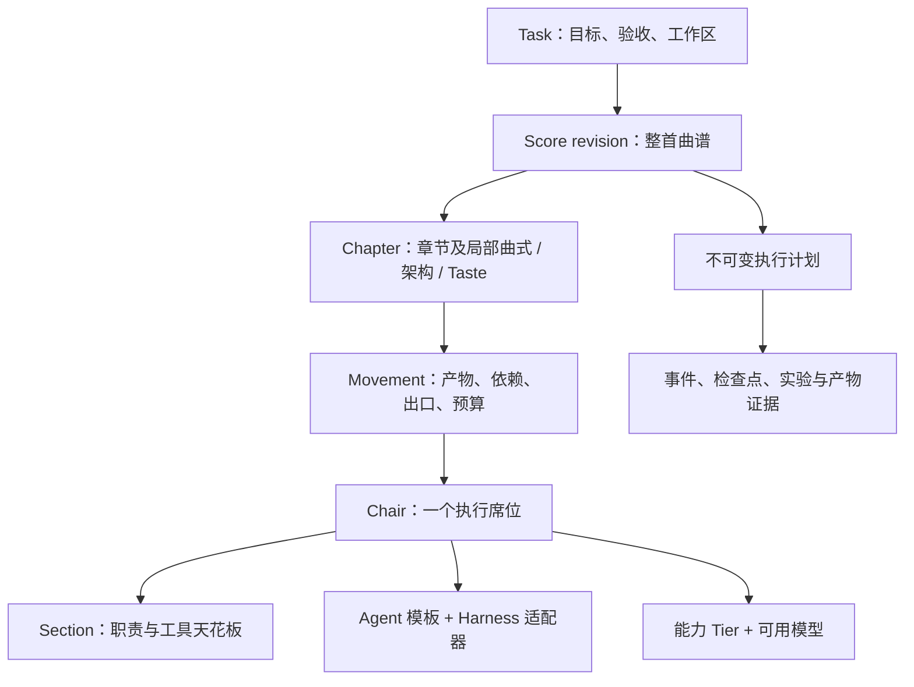

# Concert Hall：任务驱动的乐团大厅

**状态：设计 RFC，尚未实现新的复合曲谱编译器或持久化 Loop Runner。**
本轮完成源码调研和设计纠偏，不把界面草稿当成已验证的 DSH 产品。
完整证据、边界和迁移说明见 [技术设计](CONCERT_HALL_V2.md)。

## 产品重心

以任务为主角：**定义目标 → 选择架构与方法 → 起谱 → 排乐章和席位 → 预演 → 执行与复盘**。
Philharmonie 自己拥有大厅、编辑器和运行状态；DSH 是一个宿主适配器。
聊天是可打开的协作界面，不再决定任务能否被创建、编辑或恢复。

前两步保留其价值：v1 曲谱、模型 tier 解析、spawn 门闩和运行观测是底座。
现有 WebUI 草稿主要是状态监视器，下一步应增加真正的任务与曲谱创作层。

## 先拆开六个容易混淆的维度

| 维度 | 例子 | 对编排的意义 |
|---|---|---|
| 任务族 | 软件交付、内核修复、AI4S 研究 | 输入、验收、产物和风险边界 |
| 部署形态 | Serverless、本地、集群 | 环境能力、资源与发布约束 |
| 架构组合 | Microkernel、EDA、DDD | 模块、领域、事件边界及验证义务 |
| 曲式 | 奏鸣曲、赋格、发展变奏、实验循环 | 顺序、并行、汇合、重复与出口 |
| Taste | 简洁接口、显式依赖、可访问性、可复现性 | 审查准则及可自动化的检查 |
| 席位绑定 | Agent 模板、Harness、模型 tier 与实际模型 | 谁执行、怎样执行、可使用什么能力 |

Serverless 和 DDD 可以组合；不同章节也可以使用不同曲式和局部架构。
但组合必须产生可检查的义务，不能把所有架构勾选上就称为“最佳架构”。
EDA 暂按事件驱动架构理解；若指电子设计自动化，应增加独立的硬件任务族。

## 最小领域模型



**声部不是实例。** `frontend.impl` 和 `backend.impl` 可以是两个 Violin I 席位，
各自绑定模型、运行时和 worktree；Violin I 的工具上限仍由同一契约约束。
舞台位置与图标属于布局，改变执行者、依赖或工具范围才是编排修改。

**Agent 不是模型。** 席位分别配置指令/技能模板、工具子集、Harness、能力 tier 和模型。
不能仅换一个模型名称，就声称换了 Agent 或具备另一宿主的工具能力。

**Task 不是 DSH Session。** 一个长任务可关联多个 DSH 会话、CLI 进程或本地实验。
使用稳定的 chapter/movement/chair ID；运行再带上 revision、iteration 和 execution ID。

当前 v1 生成器只有四段单层流程，Section 名同时被用作席位身份；这些限制应在
新的创作模型与编译器中解决，而不是往 v1 JSON 塞入没有执行语义的新字段。
目前 `max_turns` 也是计划字段，spawn 并未强制轮次上限；状态汇聚器不是调度器，
尚无持久化暂停/恢复或实验决策引擎。新 Runner 必须真实执行约束，或明确报告不支持。

## 一个长曲谱如何混合架构与风格

软件交付示例：前后端平台，目标为 Serverless，领域复杂时采用 DDD，
指定交互才使用 EDA；确有扩展需求时，单独设计 Microkernel 边界。

| 章节 | 曲式 / 约束 | 声部编排 | 结束证据 |
|---|---|---|---|
| I. 定调与契约 | 奏鸣曲 | Oboe；需外部调查时加入 Flute | SPEC、接口/数据契约、锁定测试 |
| II. 领域构建 | 发展变奏；DDD 按需启用 | Violin I 小步实现，Violin II 对位 | 边界上下文、依赖规则、领域不变量 |
| III. 前后端展开 | 赋格 | 两个独立 Violin I 席位 | 同一契约下的独立补丁与验证 |
| IV. 扩展与集成 | 局部 Microkernel / EDA | Horn、Viola、Violin II | 扩展协议、事件 schema、幂等/回放等所选义务 |
| V. 齐奏与交付 | 集成、Serverless 适配 | Conductor、Snare、Cymbals | 合并候选、四级检查与运行/发布证据 |

同一任务可跨章节改变风格，仍共享验收目标和 ground bass。
变更架构若影响已锁定契约，应显式规划迁移，不能回头修改已通过的验收标准。

## AI4S / autoresearch 的曲谱

章节为：**研究协议 → 基线 → 多轮发展变奏 → 独立复验与报告**。
每轮变奏内部是有限流程：

```text
假设 → 候选补丁 → 预检 → 实验运行 → 提取有效指标 → 独立比较
     → keep / discard → 持久化检查点 → 下一轮
```

- 实验迭代与失败重试分别计数；discard 不等于 Harness 出错。
- 实验进程的 crash 进入明确的结果归类/重试策略；通用验证 Gate 失败仍按其断路策略处理，不可一概放行。
- 先锁定评估器、数据、指标方向、比较规则和资源条件。改变它们应建立新基线或比较组。
- 记录候选代码、父基线、数据/评估版本、硬件、指标与原始日志引用。
- 原 autoresearch 的 crash 记录可能把指标写成 0；归一化后应是 crash + 缺失指标，不能在最小化曲线上成为冠军。
- 比较同等效果下的“更简洁”，需要明确审查准则；不能伪造一个机器测量值。
- Loop 有明确的迭代、墙钟、GPU/CPU、LLM 预算与停止条件，支持暂停、取消和恢复。
- Snare 的 0-token 指不消耗 LLM Token；GPU 训练仍有时间和资源成本。

原版 autoresearch 使用单 NVIDIA GPU、固定 300 秒训练时间，启动/编译/评估另计；
不能把五分钟训练预算直接当成整个进程的五分钟超时。
本轮没有执行任何研究任务或模型调用。
评估器保护仍需验证真实的隔离边界；现有可选 `--lock-bass` 是 chmod，不是操作系统沙箱。

## 前端应该如何呈现

```text
任务库       目标 / 验收 / 架构组合 / 资源 / 曲谱版本
             [整体 Ribbon：章节 · 主奏 · Loop 进度 · 下一道 Gate]
──────────────────────────────────────────────────────────
任务列表     起谱 | 舞台 | 曲谱 | 演奏记录          检查器
软件任务     章节时间线、声部舞台、依赖、循环组     Agent / Harness
研究任务     待触发 cue、当前决策、缺失能力         Tier / 模型
曲谱模板     产物、变奏台账、候选比较               契约 / 预算 / 证据
──────────────────────────────────────────────────────────
             可展开的会话 / 研究笔记
```

起谱页承担创作：选择任务模板、按章换曲式、增加并行声部、设置 Loop 边界和验收。
舞台页承担排座：按声部分组，可看清每个席位实际绑定的 Agent、模型与执行环境。
曲谱页承担编辑：先支持序列、并行组、有限 Loop，改变曲式时展示编排差异。
演奏记录承担证据：图谱、时间线、实验台账从同一执行日志派生。

上百轮实验在概览中应是一个可展开的 Loop 组，而不是上百个大节点。
演奏视图中的 baseline / best / last 只统计有效结果；崩溃和被丢弃候选仍可追溯。
“预演”展示编译计划与缺失能力，不伪装成已经唤醒了 Agent。

## DSH 现有组件怎么适配

已核实官方固定提交 `687f282e`：

1. 用 `sidebar.panellist` + `main` 放独立大厅。这是支持的全局入口，不依赖会话存在。
2. 用 `conversation.session.header.actions` 放紧凑任务指示器/大厅入口。
   它是标题旁动作区，空白会话会隐藏，因此不能承载完整产品入口。
3. `conversation.view` 可加入当前会话的曲谱/运行检查视图，空白会话也不会渲染它。
4. 研究公开的 `conversation.content` Factory，把 DSH body/composer 接到大厅可选会话区。
   同一 Session 不可同时挂载两个可编辑 composer；嵌入能力需单独验证。
5. 保留原 Header 的标题、导航、tabs 和桌面拖拽行为。官方 header 具有两列网格和桌面几何约束，不能只插一段 JSX 就认为兼容。
6. 不占用已经有官方 occupant 的 single corner/lineage，也不依赖私有 React 组件路径。
7. 优先使用公开 primitives、theme tokens 和 observable store 接口，做薄适配。

独立大厅自己提供全宽 Ribbon；**没有必要为此先 fork 整个 DSH**。
未来若向官方增加插槽，应同时修改类型、children 声明、渲染共享、位置和布局，并验证桌面/窄屏/卸载生命周期。
调研依据是源码与文档，不是运行中的 DSH 截图。

## 下一次实现的最小闭环

1. 创作模型和读取/编译器一起落地：章节、稳定席位 ID、曲式与局部架构/Taste；保留 v1 兼容。
2. 做两张能编辑和预演的长曲谱：前后端交付、有限 AI4S 研究；独立于 DSH 启动。
3. 以现有 spawn/验证闩扩展持久化 Runner，先通过假实验 fixture 验证恢复、汇合、scope 和指标证据。
4. 再接 DSH 的全局入口、紧凑动作和可选会话视图；不让 Session 切换改变任务身份。

前两步现有 PR 提供底座，不代表新的编辑器、复合编译器或持久化 Loop 已完成。
两份 JSON 位于 `design/examples/`，只表达领域关系，明确标记为不可执行。
完整源码来源与验收场景列在 [技术设计](CONCERT_HALL_V2.md#sources)。
